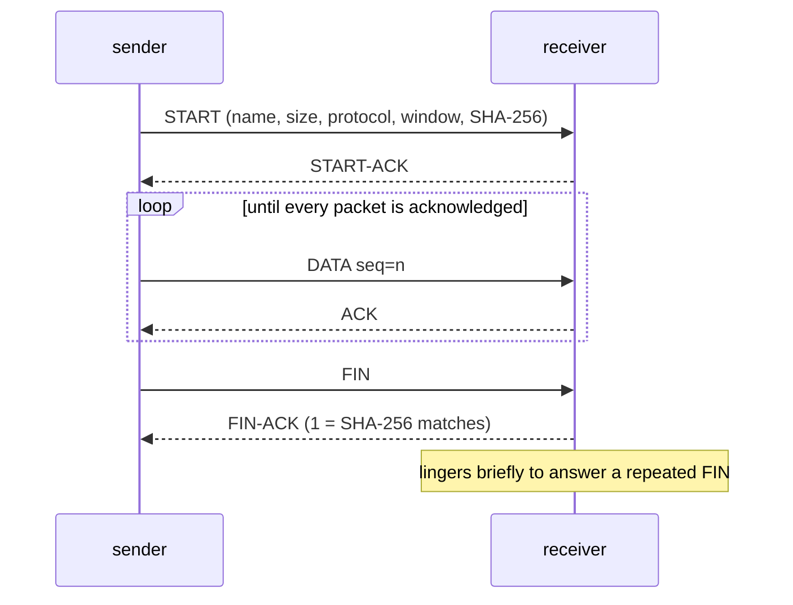
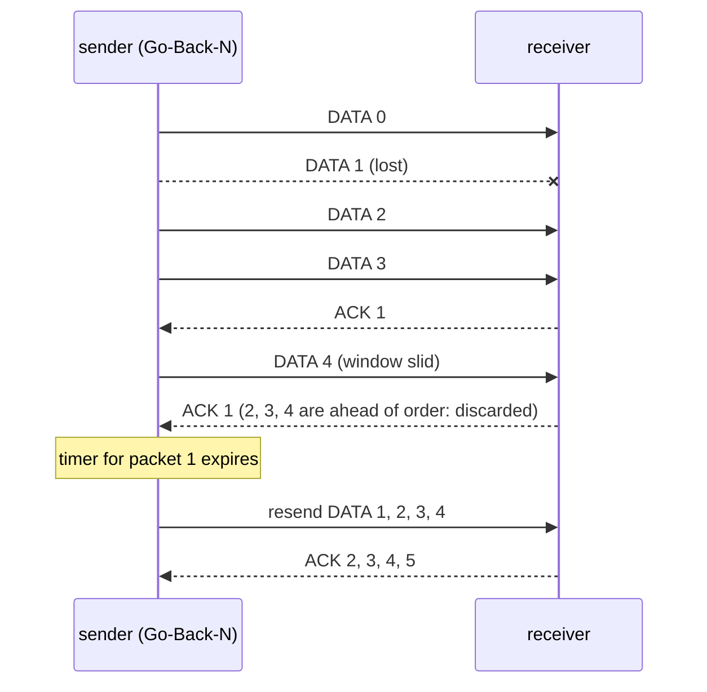
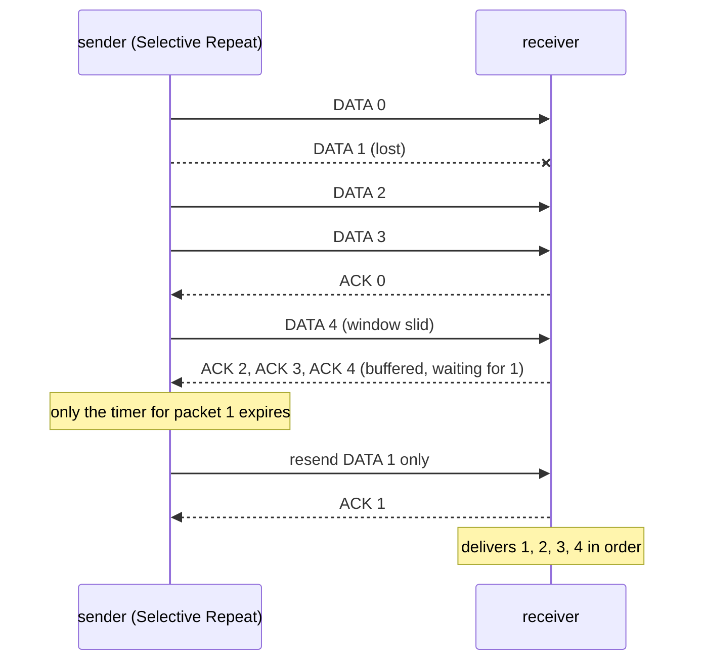
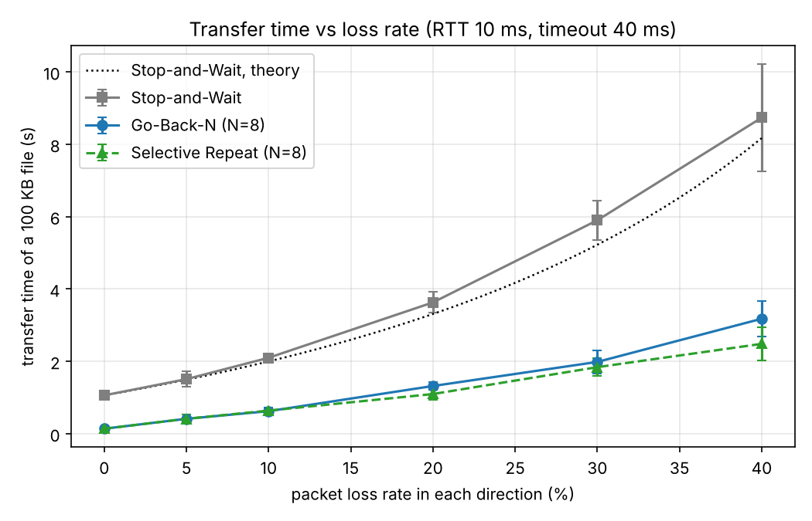
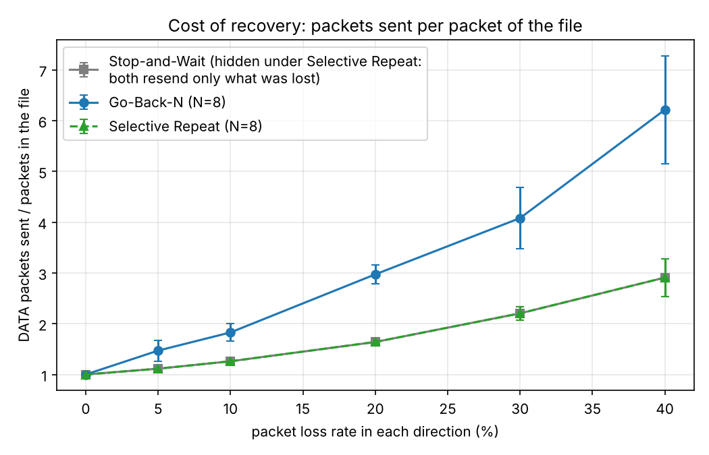
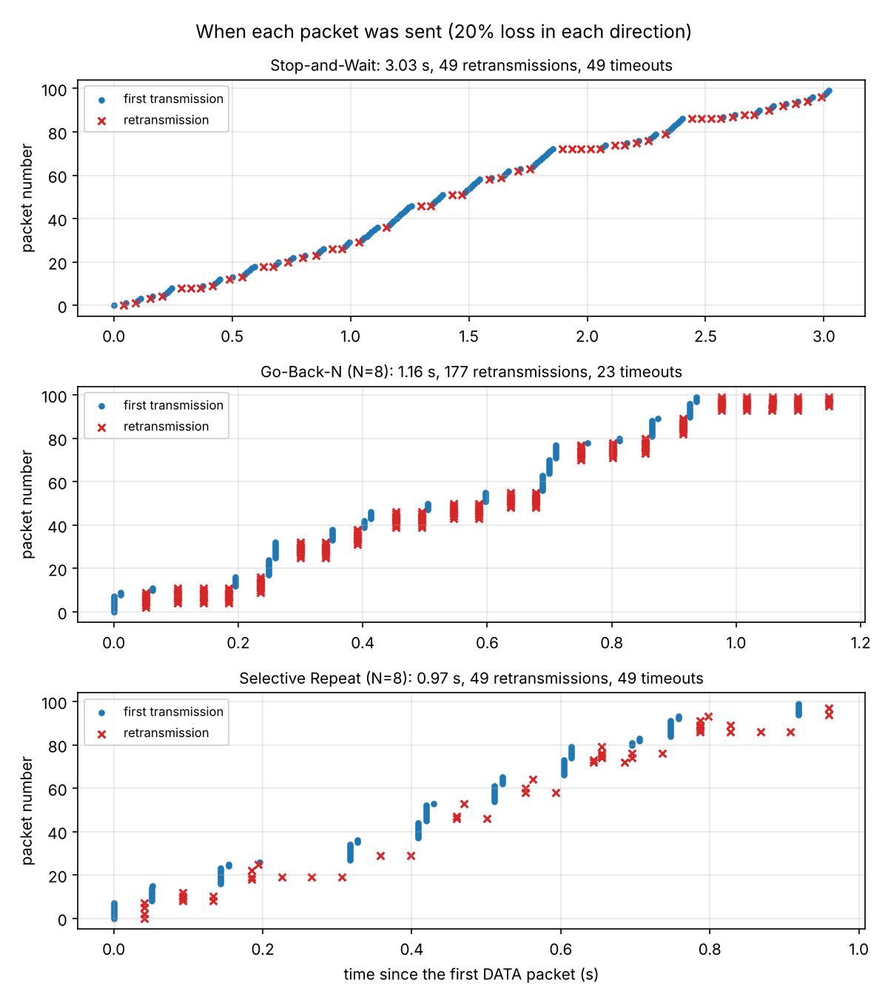
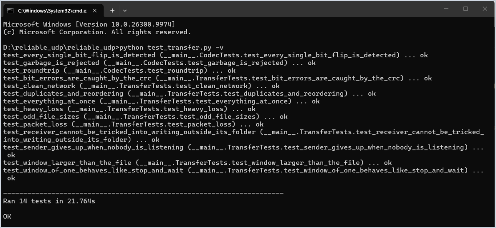
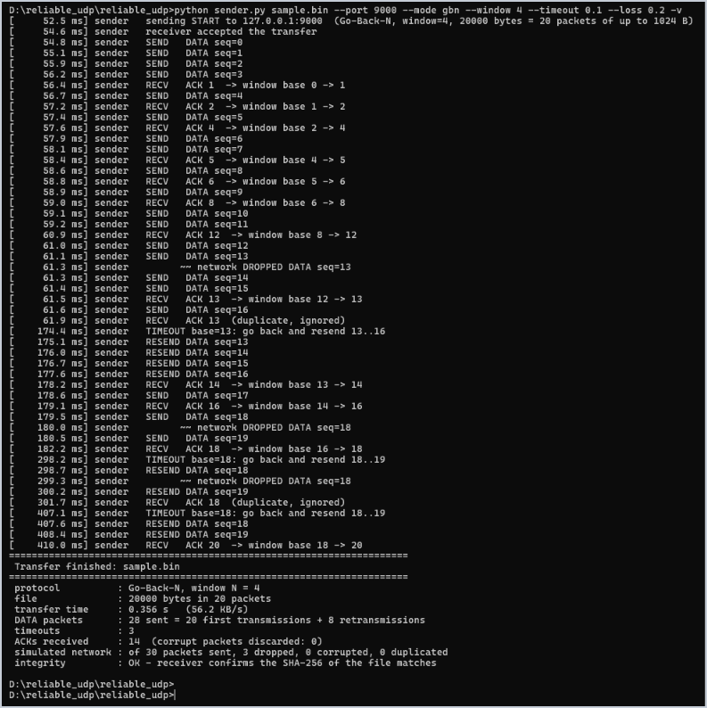
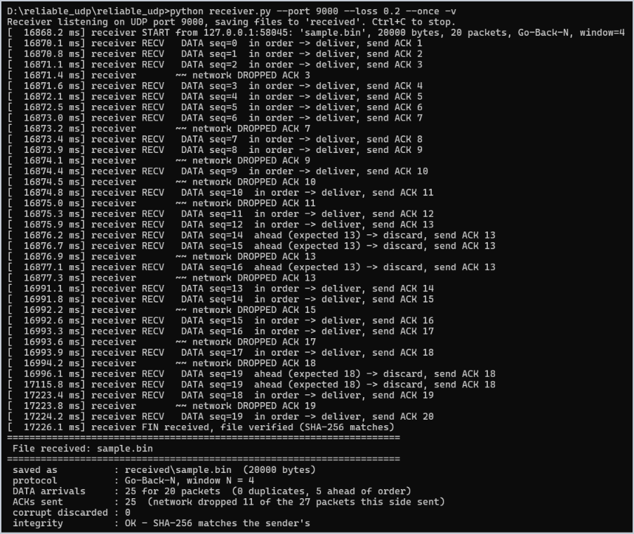

<div align="center">

# Reliable File Transfer over UDP

*Stop-and-Wait, Go-Back-N and Selective Repeat, written from scratch in Python*


[Overview](#overview) &nbsp;·&nbsp; [Getting started](#getting-started) &nbsp;·&nbsp; [How it works](#how-it-works) &nbsp;·&nbsp; [Results](#results) &nbsp;·&nbsp; [Screenshots](#screenshots) &nbsp;·&nbsp; [Tests](#tests)

</div>

<br>

## Overview

UDP is fast and simple, and it promises nothing. A packet can get lost, arrive with a flipped bit, arrive twice or show up out of order, and neither side is told. That is fine for a video call. It is useless for a file, where one wrong byte ruins the whole thing.

TCP hides all of this from us. I wanted to see what is underneath, so I rebuilt the same machinery by hand on top of plain UDP sockets: sequence numbers, acknowledgements, timers, retransmission, a sliding window and checksums. Three classic protocols are implemented, **Stop-and-Wait**, **Go-Back-N** and **Selective Repeat**, and all three are tested on the same simulated bad network so they can be compared fairly.

The repository holds a sender and a receiver you can run in two terminals, a small network simulator that drops, corrupts, duplicates and delays packets on purpose, a test suite, and the scripts that produced the measurements further down. It was written for the CSN 303 (Computer Networks) course and uses only the Python standard library.

To give a taste of the results: sending a 100 KB file over a link that loses 20% of its packets took 3.63 s with Stop-and-Wait, 1.32 s with Go-Back-N and 1.10 s with Selective Repeat. All 190 transfers in the experiments delivered a file identical to the original.

## Getting started

You need Python 3.8 or newer. Nothing has to be installed (matplotlib is only needed if you want to redraw the plots).

```bash
git clone https://github.com/<your-username>/reliable-udp-transfer.git
cd reliable-udp-transfer

python test_transfer.py -v                 # all 14 tests should say ok
python experiments.py demo --loss 0.2      # the three protocols side by side, about 10 seconds
```

On Linux or macOS, use `python3` if `python` is not found.

The demo sends the same 100 KB file with each protocol over a link that loses 20% of the packets in each direction. One run looks like this (the exact numbers change a little every time):

```
 protocol                   time (s)      KB/s  DATA sent   retrans.  timeouts   file
 Stop-and-Wait                  6.07      16.5        163         63        63   intact (SHA-256 OK)
 Go-Back-N (N=8)                1.79      55.8        284        184        23   intact (SHA-256 OK)
 Selective Repeat (N=8)         1.37      72.8        163         63        63   intact (SHA-256 OK)
```

### Sending a file between two terminals

First make a small test file, then start the receiver in one terminal and the sender in another. Start the receiver first.

```bash
python -c "import os; open('sample.bin','wb').write(os.urandom(20000))"

# terminal 1
python receiver.py --port 9000 --loss 0.2 --once -v

# terminal 2
python sender.py sample.bin --port 9000 --mode gbn --window 4 --timeout 0.1 --loss 0.2 -v
```

`--mode` picks the protocol (`saw`, `gbn` or `sr`). The receiver learns the protocol and the window size from the sender, so it needs no `--mode` of its own. `--loss 0.2` is given to both programs on purpose: the sender's network drops 20% of the DATA packets and the receiver's network drops 20% of the ACKs. With `-v` you can watch every send, ACK, drop, timeout and resend; without it you only get the summary at the end:

```
 protocol          : Go-Back-N, window N = 4
 file              : 20000 bytes in 20 packets
 transfer time     : 0.356 s   (56.2 KB/s)
 DATA packets      : 28 sent = 20 first transmissions + 8 retransmissions
 timeouts          : 3
 ACKs received     : 14  (corrupt packets discarded: 0)
 simulated network : of 30 packets sent, 3 dropped, 0 corrupted, 0 duplicated
 integrity         : OK - receiver confirms the SHA-256 of the file matches
```

The received file is saved in `./received/` and both programs check its SHA-256. If you want to check it yourself, use `sha256sum FILE` on Linux, `shasum -a 256 FILE` on macOS or `certutil -hashfile FILE SHA256` on Windows.

To try it between two machines, run the receiver on one, pass `--host <receiver IP>` to the sender, and allow UDP port 9000 through the firewall.

<details>
<summary><b>All command-line options</b></summary>

<br>

**`sender.py FILE`**

| option | default | meaning |
|---|---|---|
| `--host` | `127.0.0.1` | receiver address |
| `--port` | `9000` | receiver UDP port |
| `--mode` | `gbn` | `saw`, `gbn` or `sr` |
| `--window` | `8` | window size N in packets (for `gbn` and `sr`) |
| `--chunk` | `1024` | payload bytes per packet, 1 to 1400 |
| `--timeout` | `0.2` | retransmission timeout in seconds |
| `--max-retries` | `50` | give up after this many timeouts without progress |
| `-v`, `--verbose` | off | log every packet event |

**`receiver.py`**

| option | default | meaning |
|---|---|---|
| `--host` | `0.0.0.0` | address to listen on |
| `--port` | `9000` | UDP port |
| `--out-dir` | `received` | folder for received files |
| `--idle-timeout` | `30` | abort a transfer if the sender is silent this long (seconds) |
| `--linger` | `2.0` | seconds to keep answering FIN after finishing |
| `--once` | off | exit after one file instead of waiting for the next |
| `-v`, `--verbose` | off | log every packet event |

**Simulated network** (accepted by both programs, and applied to the packets *that program sends*)

| option | meaning |
|---|---|
| `--loss P` | probability that a packet is dropped |
| `--corrupt P` | probability that a packet has one bit flipped (the CRC then rejects it) |
| `--duplicate P` | probability that a packet is delivered twice |
| `--delay SEC` | one-way propagation delay |
| `--jitter SEC` | random extra delay between 0 and SEC, which re-orders packets |
| `--seed N` | random seed, for repeatable runs |

Probabilities must be at least 0 and below 1.

**`experiments.py`**

| command | what it does |
|---|---|
| `demo [--loss 0.2 --window 8 --size 100000 --delay 0.005 --timeout 0.04 --seed 1]` | compares the three protocols once |
| `full [--reps 5 --jobs N --out results]` | runs every experiment and writes the CSV files and plots |
| `plot [--out results]` | redraws the plots from an existing `results.csv` |

`full` and `plot` need `pip install matplotlib`.

</details>

## How it works

### The packet

Every UDP datagram carries exactly one packet, laid out like this (all numbers big-endian):

```
| type 1 B | sequence number 4 B | payload length 2 B | CRC-32 4 B | payload 0 to 1400 B |
```

| type | value | direction | purpose |
|---|---|---|---|
| `START` | 1 | sender to receiver | file name, size, protocol, window and SHA-256 (JSON payload) |
| `START-ACK` | 2 | receiver to sender | the transfer is accepted |
| `DATA` | 3 | sender to receiver | `seq` is the packet number, the payload is a piece of the file |
| `ACK` | 4 | receiver to sender | cumulative for saw and gbn, one packet at a time for sr |
| `FIN` | 5 | sender to receiver | every DATA packet has been acknowledged |
| `FIN-ACK` | 6 | receiver to sender | one byte: 1 if the file's SHA-256 matched, otherwise 0 |

The CRC-32 covers the header and the payload. A packet that fails the check is thrown away without a word, so a corrupted packet simply becomes a lost packet, and the retransmission machinery that handles loss handles corruption too. CRC-32 catches every single-bit error, and one of the tests flips each bit of a packet in turn to prove it. Sequence numbers count packets rather than bytes and never wrap around.

### A transfer from start to finish



START and FIN are retransmitted until they are answered. After sending FIN-ACK the receiver stays around for a moment, so that if the FIN-ACK is lost it can answer the sender's repeated FIN. TCP does the same thing with its TIME-WAIT state.

### The three protocols

| | Stop-and-Wait | Go-Back-N | Selective Repeat |
|---|---|---|---|
| packets in flight | 1 | up to N | up to N |
| receiver | accepts only the next packet | accepts only the next packet and discards the rest | buffers packets inside its window |
| meaning of `ACK n` | all packets below n arrived | the same (cumulative) | packet n arrived |
| sender timers | 1 | 1, for the oldest unacknowledged packet | 1 per packet |
| after a timeout | resend that packet | resend the whole window from the oldest packet | resend only the packet that timed out |
| main weakness | the link sits idle most of the time | resends packets that already arrived | needs more buffers and timers |

The difference shows up when a packet is lost. Here is a window of four with packet 1 lost on the way. Go-Back-N throws away everything that arrives after the gap and sends it all again:



Selective Repeat keeps the packets that did arrive and resends only the one that is missing:



### The simulated network

UDP over the loopback interface almost never loses a packet, so a protocol tested on it would look perfect no matter how it was written. To get around that, both programs send everything through a `LossyChannel` (in `channel.py`) that can drop a packet, flip one random bit in it, deliver it twice, or hold it back for a while. The probabilities are yours to choose. Because the sender and the receiver each have their own channel, DATA packets and ACKs both cross a bad network.

A fixed delay gives the link a realistic round-trip time (5 ms each way makes the RTT about 10 ms). That matters more than it sounds: with no delay at all, every protocol would finish at about the same speed and the window size would make no difference. Random jitter on top of the delay is what re-orders packets.

On Linux you can also get real loss with `sudo tc qdisc add dev lo root netem loss 10% delay 5ms` and run the programs without `--loss`. Remove it afterwards with `sudo tc qdisc del dev lo root`. The protocol code does not care where the loss comes from.

### Small safety nets

The sender gives up, and says so, when `--max-retries` timeouts pass in a row without any progress (50 by default), so a receiver that has died cannot leave it hanging forever. The receiver aborts a transfer if the sender goes quiet for `--idle-timeout` seconds. It also keeps only the base name of the file from the START packet and never a path, so a sender cannot make it write outside its `--out-dir`; the tests try names such as `../../evil.txt` to make sure of that.

## Results

All experiments send the same 100 KB file, split into 100 packets of 1000 bytes, over a link with a 5 ms one-way delay (RTT about 10 ms) and a retransmission timeout of 40 ms. Loss is applied independently to DATA packets and to ACKs. Each setting was run 5 times and averaged: 38 settings and 190 transfers in total, and every one delivered an intact file.

Two experiments were run. The first compares the three protocols at a window of N = 8 across loss rates from 0% to 40%. The second varies the window from 1 to 32 at 0% and 10% loss.

### Transfer time against loss rate

| loss | Stop-and-Wait | Go-Back-N | Selective Repeat |
|---|---|---|---|
| 0 % | 1.06 s | 0.14 s | 0.14 s |
| 5 % | 1.51 s | 0.41 s | 0.41 s |
| 10 % | 2.10 s | 0.62 s | 0.64 s |
| 20 % | 3.63 s | 1.32 s | 1.10 s |
| 30 % | 5.90 s | 1.98 s | 1.84 s |
| 40 % | 8.74 s | 3.18 s | 2.48 s |

<p align="center">
  <br>
  <sub><b>Figure 1.</b> Transfer time of the 100 KB file against packet loss rate. Error bars show one standard deviation; the dotted line is the Stop-and-Wait model.</sub>
</p>

Pipelining is the big win. With no loss at all, a window of 8 makes the transfer 7.5 times faster than Stop-and-Wait, because Stop-and-Wait sends one packet per round trip and leaves the link idle the rest of the time.

Stop-and-Wait also follows a simple model quite closely. A packet only counts as delivered if both it and its ACK get through, which happens with probability q = (1 - loss)². Each failure costs one full timeout, so the expected time is about packets × (RTT + (1/q - 1) × timeout). That is the dotted line in the figure, and the measured times sit 1 to 13% above it.

Go-Back-N and Selective Repeat are almost indistinguishable up to about 10% loss. Beyond that Selective Repeat pulls ahead, and at 40% loss it is 22% faster.

### Cost of recovery

The figure below counts how many DATA packets each protocol had to send for every packet of the file. A value of 1.0 would mean no retransmissions at all.

| loss | Go-Back-N (N = 8) | Selective Repeat (N = 8) |
|---|---|---|
| 20 % | 2.97 | 1.64 |
| 40 % | 6.2 | 2.9 |

<p align="center">
  <br>
  <sub><b>Figure 2.</b> DATA packets sent per packet of the file. Stop-and-Wait resends only what was lost, just like Selective Repeat, so its line is hidden under the Selective Repeat line.</sub>
</p>

Go-Back-N pays for its simplicity in extra traffic: at 20% loss it sends almost three packets for every packet of the file, against 1.64 for Selective Repeat.

### Effect of the window size

| setting | result |
|---|---|
| 0 % loss, N = 1 (Stop-and-Wait) | 95 KB/s |
| 0 % loss, N = 8 | 726 KB/s |
| 0 % loss, N = 32 | 2383 KB/s |
| 10 % loss, N = 2 | Go-Back-N 92 KB/s, Selective Repeat 72 KB/s |
| 10 % loss, N = 32 | Go-Back-N 182 KB/s, Selective Repeat 375 KB/s |

<p align="center">
  <br>
  <sub><b>Figure 3.</b> Throughput against window size, without loss (left) and with 10% loss (right). A window of 1 is Stop-and-Wait.</sub>
</p>

Without loss, throughput grows with the window. With loss, the larger the window, the more Selective Repeat gains over Go-Back-N: at N = 32 and 10% loss it reaches more than twice the throughput.

The result at small windows is the surprising one. At N = 2 to 4 and 10% loss, Go-Back-N was slightly *faster* than Selective Repeat. The reason is that a single cumulative ACK in Go-Back-N also covers any earlier ACK that was lost, whereas Selective Repeat needs every individual ACK to arrive.

### When each packet was sent

<p align="center">
  <br>
  <sub><b>Figure 4.</b> One real run per protocol at 20% loss. Blue dots are first transmissions, red crosses are retransmissions.</sub>
</p>

This trace shows why the protocols behave so differently. In this run Go-Back-N needed 177 retransmissions to deliver 100 packets, and the tall columns of red crosses are whole windows being sent again after a timeout. Selective Repeat needed 49, each one a single packet that had really been lost, and finished first at 0.97 s.

### Two caveats

The simulated link has unlimited bandwidth, so the extra packets Go-Back-N sends cost it nothing in time here. On a real link with a bottleneck they would slow it down even more, so the gap in practice would likely be wider than measured. And absolute times depend on the machine, so compare the ratios between protocols rather than the raw seconds.

### Reproducing the results

```bash
pip install matplotlib
python experiments.py full --reps 5        # about 2 minutes
```

This rewrites `results/results.csv` (every run), `results/summary.csv` (means and standard deviations) and the four figures. The transfers are timing-based, so your numbers will differ slightly from the ones above.

## Screenshots

Output from real runs on a Windows machine. Click any image to open it at full size.

<table>
<tr>
<th align="center">All 14 tests pass</th>
<th align="center">Demo at 20% loss</th>
</tr>
<tr>
<td align="center"><a href="docs/screenshots/01_tests_pass.png"></a></td>
<td align="center"><a href="docs/screenshots/02_demo_20pct_loss.png"></a></td>
</tr>
<tr>
<th align="center">Go-Back-N: sender</th>
<th align="center">Go-Back-N: receiver</th>
</tr>
<tr>
<td align="center"><a href="docs/screenshots/03_gbn_sender.png"></a></td>
<td align="center"><a href="docs/screenshots/04_gbn_receiver.png"></a></td>
</tr>
<tr>
<th align="center">Stop-and-Wait: sender</th>
<th align="center">Stop-and-Wait: receiver</th>
</tr>
<tr>
<td align="center"><a href="docs/screenshots/05_saw_sender.png"></a></td>
<td align="center"><a href="docs/screenshots/06_saw_receiver.png"></a></td>
</tr>
<tr>
<th align="center">Selective Repeat: sender</th>
<th align="center">Selective Repeat: receiver</th>
</tr>
<tr>
<td align="center"><a href="docs/screenshots/07_sr_sender.png"></a></td>
<td align="center"><a href="docs/screenshots/08_sr_receiver.png"></a></td>
</tr>
</table>

In the sender logs, look for the `DROPPED`, `TIMEOUT` and `RESEND` lines to see the recovery at work. Every run ends with the receiver confirming that the SHA-256 of the file matches.

## Project layout

```
reliable-udp-transfer/
├── protocol.py        packet format (11-byte header + CRC-32), encode and decode
├── channel.py         LossyChannel: loss, bit errors, duplicates, delay and re-ordering
├── sender.py          the three sender protocols and the command-line tool
├── receiver.py        the receiver (cumulative ACKs for saw/gbn, buffering for sr) and its CLI
├── experiments.py     runs sender and receiver in one process: demo, full experiments, plots
├── test_transfer.py   the 14 automated tests
├── results/           results.csv (all 190 runs), summary.csv, fig1 to fig4, sample_logs/
├── docs/screenshots/  terminal screenshots of the tests, the demo and the real runs
├── requirements.txt   matplotlib, needed only for the plots
├── LICENSE
└── README.md
```

## Tests

```bash
python test_transfer.py -v
```

The suite takes about 20 seconds. For every protocol, the received file has to be identical to the original on a clean network, at 20% and at 40% loss, with 15% of the packets bit-flipped, with duplicates and re-ordering, and with all of those at once. The other tests cover file sizes of 0, 1, 999, 1000, 1001 and 5000 bytes, a window of 1 (which should behave like Stop-and-Wait), a window larger than the whole file, a sender that must give up when nobody is listening, a receiver that is sent hostile file names, and the packet codec itself (round trip, garbage rejected, every single-bit flip detected).

## Troubleshooting

| symptom | what to do |
|---|---|
| `no answer from receiver ... is receiver.py running?` | Start the receiver first and check that the host and port match. |
| `cannot listen on 0.0.0.0:9000` | The port is already in use. Choose another with `--port` on both programs. |
| Works on one machine but not between two | Allow UDP port 9000 in the receiver's firewall and pass `--host <receiver IP>` to the sender. |
| Only one direction seems lossy | `--loss` and the other damage options apply to what *that program* sends, so give them to both. |
| Odd timings on Windows | The system timer can be coarse (around 15 ms), which blurs the 5 ms delay. Try `python experiments.py demo --delay 0.02 --timeout 0.15`. |

## Limitations

The receiver serves one sender at a time and then waits for the next. The window size is fixed, with no congestion control or flow control. And there is no encryption or authentication: CRC-32 and SHA-256 catch accidental damage, not tampering.

## References

1. J. F. Kurose and K. W. Ross, *Computer Networking: A Top-Down Approach*, 8th ed. Pearson, 2021.
2. A. S. Tanenbaum, N. Feamster and D. Wetherall, *Computer Networks*, 6th ed. Pearson, 2021.
3. J. Postel, "User Datagram Protocol," RFC 768, IETF, August 1980. <https://www.rfc-editor.org/info/rfc768>

<br>

<div align="center">

Made by Rishabh Mishra for CSN 303 &nbsp;·&nbsp; Released under the [MIT License](LICENSE)

</div>
