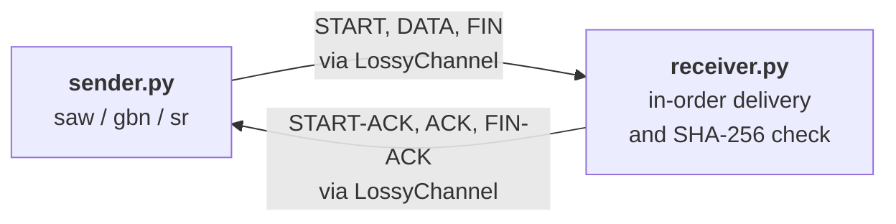
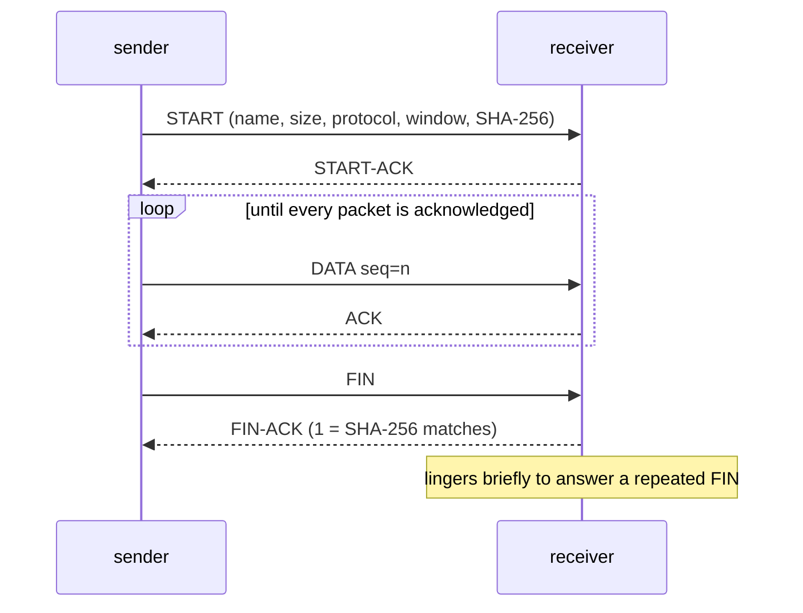
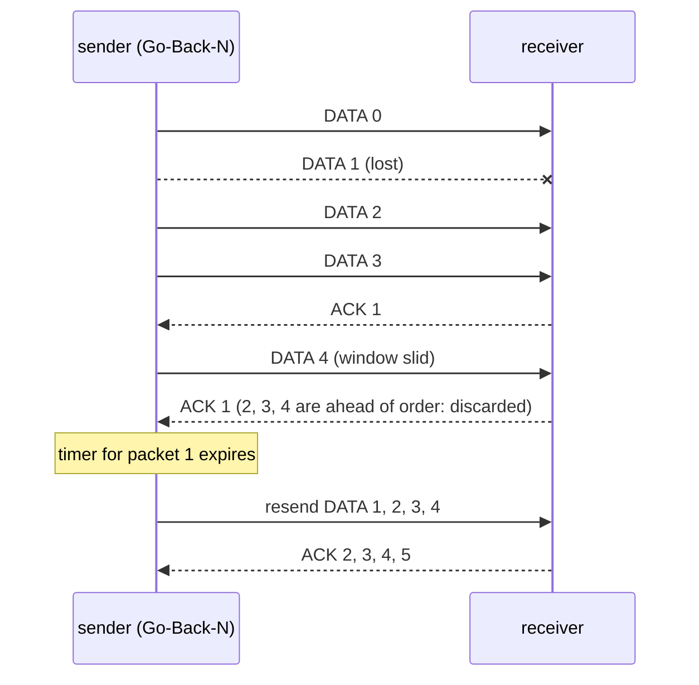
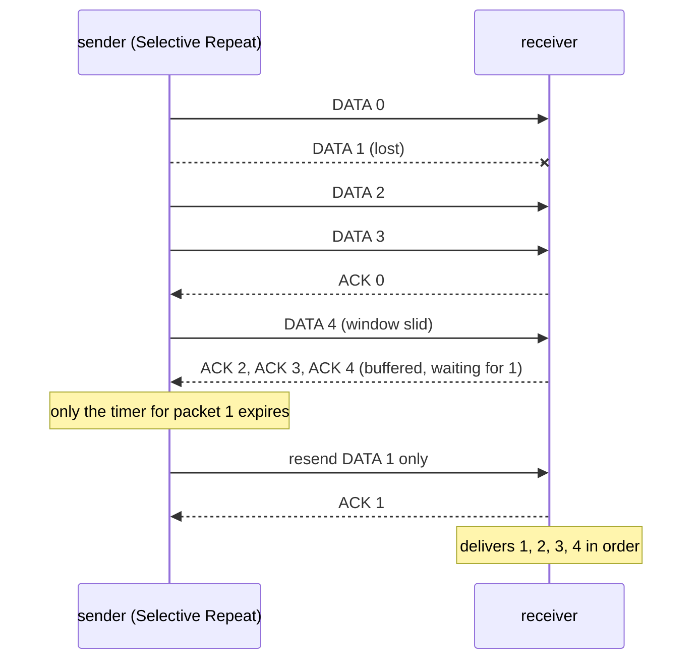
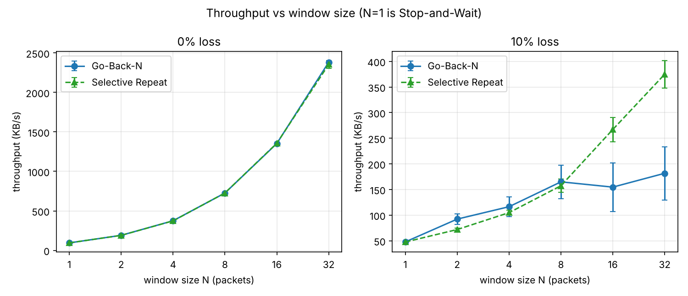
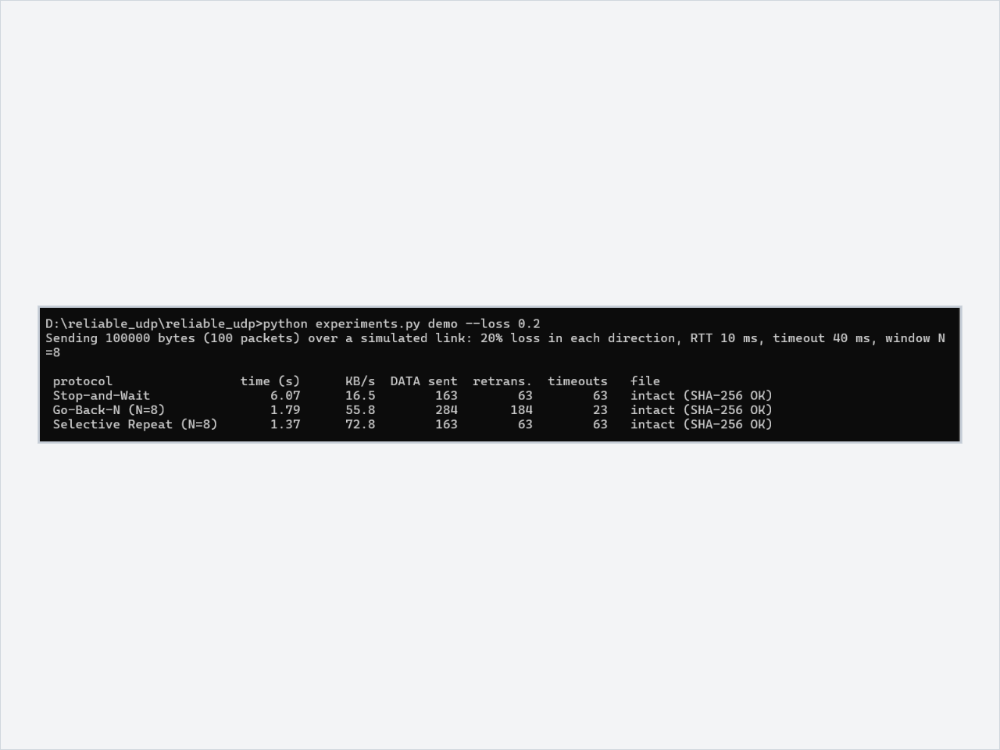
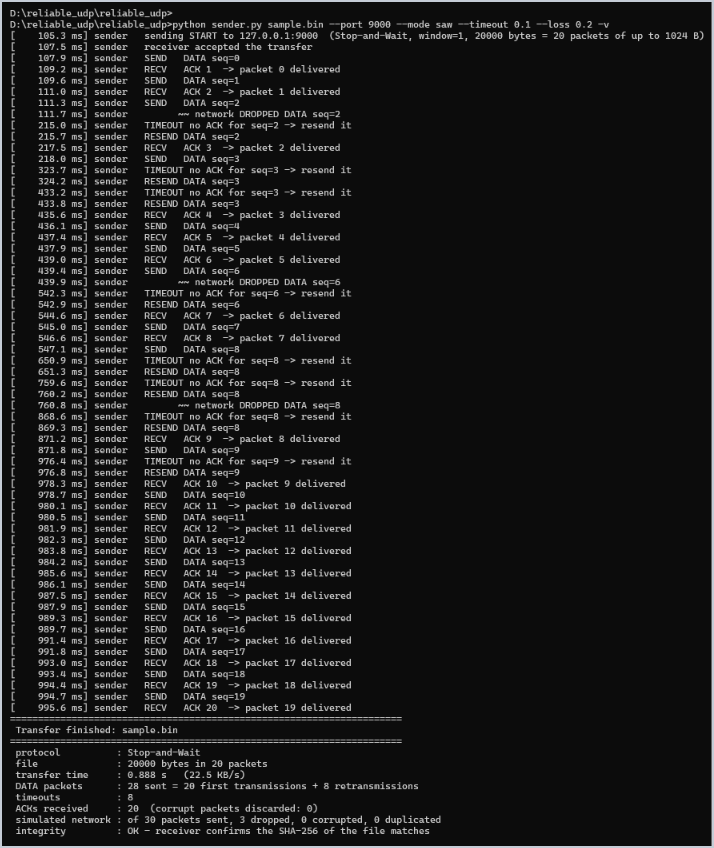
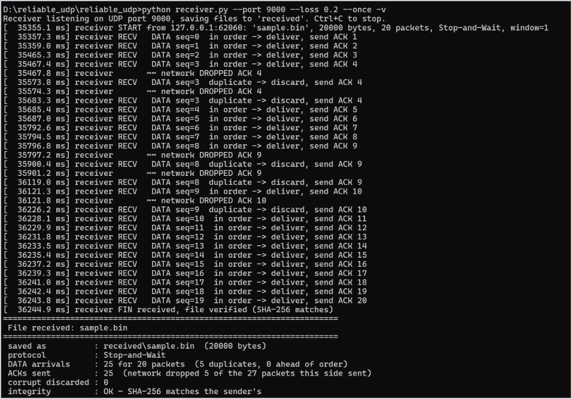
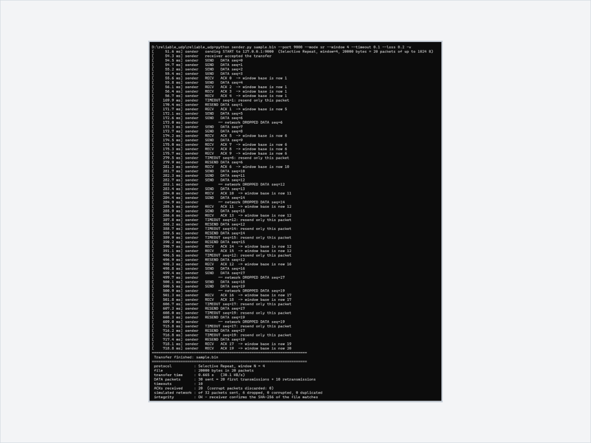
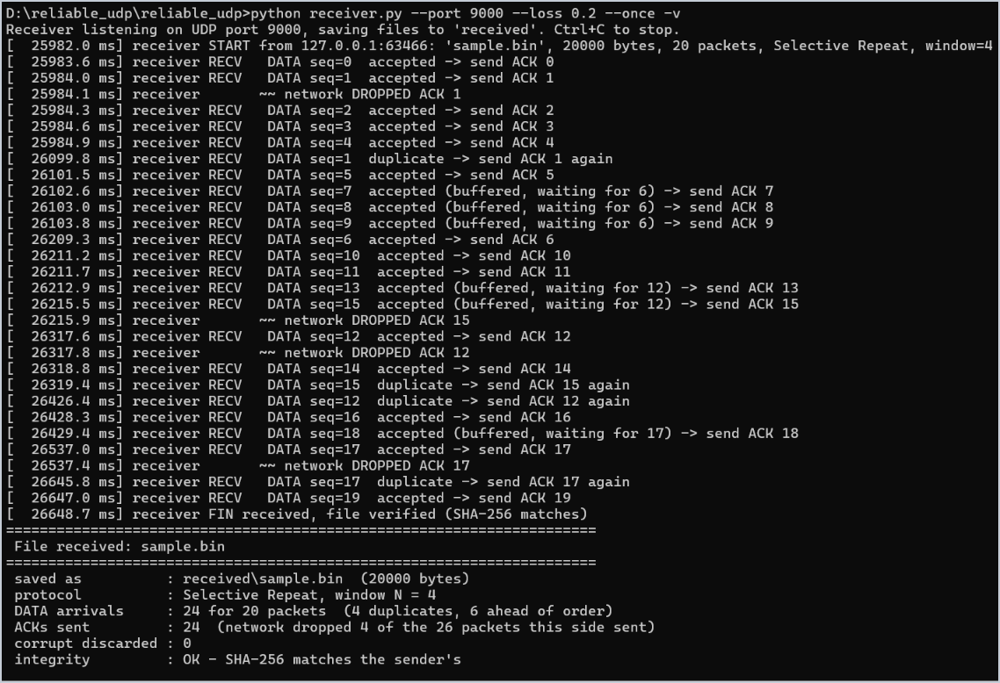

# Reliable File Transfer over UDP


**Send a file over plain UDP and get it back byte-for-byte intact, even when the network drops, corrupts, duplicates or re-orders packets.**

UDP promises nothing: packets can vanish, arrive damaged, arrive twice or arrive out of order, and nobody is told. This project builds the missing reliability by hand (sequence numbers, ACKs, timeouts, retransmission, a sliding window, checksums) and implements three classic protocols so they can be compared on the same simulated bad network:

**Stop-and-Wait**, **Go-Back-N** and **Selective Repeat**.


### Results at a glance

Mean time to send a 100 KB file (RTT 10 ms, window N = 8, packet loss applied in both directions, 5 runs per cell):

| packet loss | Stop-and-Wait | Go-Back-N | Selective Repeat |
|---|---|---|---|
| 0 % | 1.06 s | 0.14 s | 0.14 s |
| 20 % | 3.63 s | 1.32 s | 1.10 s |
| 40 % | 8.74 s | 3.18 s | 2.48 s |

All 190 experiment transfers delivered an intact file. [Full results below.](#results)

## Contents

- [Features](#features)
- [Quick start](#quick-start)
- [Command-line reference](#command-line-reference)
- [How it works](#how-it-works)
- [Results](#results)
- [Sample runs](#sample-runs)
- [Project structure](#project-structure)
- [Tests](#tests)
- [Troubleshooting](#troubleshooting)
- [Limitations](#limitations)
- [References](#references) 

## Features

- Three reliable-transfer protocols, chosen with `--mode saw | gbn | sr`
- Own packet format with a CRC-32 on every packet and a SHA-256 check of the whole file at the end
- `LossyChannel`: a software model of a bad network that drops, bit-flips, duplicates, delays and re-orders packets, with probabilities you choose
- Experiment runner that measures all three protocols (190 transfers) and draws the plots
- 14 automated tests, including odd file sizes and hostile file names
- Runs on one machine over loopback: no root access, no Linux-only features, no dependencies (matplotlib only for plots)

## Quick start

```bash
git clone https://github.com/<your-username>/reliable-udp-transfer.git
cd reliable-udp-transfer

python test_transfer.py -v                 # all 14 tests should say ok
python experiments.py demo --loss 0.2      # the three protocols side by side, about 10 s
```

On Linux or macOS use `python3` if `python` is not available.

Example output of the demo (one run, 20% loss in each direction):

```
 protocol                   time (s)      KB/s  DATA sent   retrans.  timeouts   file
 Stop-and-Wait                  6.07      16.5        163         63        63   intact (SHA-256 OK)
 Go-Back-N (N=8)                1.79      55.8        284        184        23   intact (SHA-256 OK)
 Selective Repeat (N=8)         1.37      72.8        163         63        63   intact (SHA-256 OK)
```

### A real two-terminal transfer

```bash
python -c "import os; open('sample.bin','wb').write(os.urandom(20000))"     # make a 20 KB test file

# terminal 1: start the receiver first
python receiver.py --port 9000 --loss 0.2 --once -v

# terminal 2: send the file with Go-Back-N, window 4
python sender.py sample.bin --port 9000 --mode gbn --window 4 --timeout 0.1 --loss 0.2 -v
```

- `--loss 0.2` is given to **both** programs: the sender's network drops 20% of DATA packets and the receiver's network drops 20% of ACKs.
- The receiver learns the protocol and window size from the sender, so it needs no `--mode`.
- Without `-v` you only get the final summary. With `-v` you see every send, ACK, drop, timeout and resend.
- The received file is saved in `./received/`. Both programs verify its SHA-256. To check it yourself: `sha256sum FILE` (Linux), `shasum -a 256 FILE` (macOS) or `certutil -hashfile FILE SHA256` (Windows).
- **Two machines:** run the receiver on one, give the sender `--host <receiver IP>`, and allow UDP port 9000 in the firewall.

The end of the sender's output looks like this:

```
 protocol          : Go-Back-N, window N = 4
 file              : 20000 bytes in 20 packets
 transfer time     : 0.356 s   (56.2 KB/s)
 DATA packets      : 28 sent = 20 first transmissions + 8 retransmissions
 timeouts          : 3
 ACKs received     : 14  (corrupt packets discarded: 0)
 simulated network : of 30 packets sent, 3 dropped, 0 corrupted, 0 duplicated
 integrity         : OK - receiver confirms the SHA-256 of the file matches
```

## Command-line reference

### `sender.py FILE`

| option | default | meaning |
|---|---|---|
| `--host` | `127.0.0.1` | receiver address |
| `--port` | `9000` | receiver UDP port |
| `--mode` | `gbn` | `saw`, `gbn` or `sr` |
| `--window` | `8` | window size N in packets (for `gbn` and `sr`) |
| `--chunk` | `1024` | payload bytes per packet (1 to 1400) |
| `--timeout` | `0.2` | retransmission timeout in seconds |
| `--max-retries` | `50` | give up after this many timeouts without progress |
| `-v`, `--verbose` | off | log every packet event |

### `receiver.py`

| option | default | meaning |
|---|---|---|
| `--host` | `0.0.0.0` | address to listen on |
| `--port` | `9000` | UDP port |
| `--out-dir` | `received` | folder for received files |
| `--idle-timeout` | `30` | abort a transfer if the sender is silent this long (s) |
| `--linger` | `2.0` | seconds to keep answering FIN after finishing |
| `--once` | off | exit after one file instead of waiting for the next |
| `-v`, `--verbose` | off | log every packet event |

### Simulated network (both programs)

Applied to the packets **that program sends**, so give the same options to both sender and receiver to damage both directions.

| option | meaning |
|---|---|
| `--loss P` | probability a packet is dropped |
| `--corrupt P` | probability a packet has one bit flipped (the CRC then rejects it) |
| `--duplicate P` | probability a packet is delivered twice |
| `--delay SEC` | one-way propagation delay |
| `--jitter SEC` | random extra delay in [0, SEC], which re-orders packets |
| `--seed N` | random seed, for repeatable runs |

Probabilities must be in [0, 1).

### `experiments.py`

| command | what it does |
|---|---|
| `demo [--loss 0.2 --window 8 --size 100000 --delay 0.005 --timeout 0.04 --seed 1]` | compare the three protocols once (about 10 s) |
| `full [--reps 5 --jobs N --out results]` | run every experiment, write `results.csv`, `summary.csv` and the plots |
| `plot [--out results]` | redraw the plots from an existing `results.csv` |

`full` and `plot` need `pip install matplotlib`.

## How it works

Both programs send through a `LossyChannel`, so DATA packets and ACKs both cross the same kind of bad network:



### Packet format

Every UDP datagram carries exactly one packet. All numbers are big-endian.

```
| type 1B | sequence number 4B | payload length 2B | CRC-32 4B | payload 0..1400 B |
```

| type | value | direction | purpose |
|---|---|---|---|
| `START` | 1 | sender to receiver | file name, size, protocol, window, SHA-256 (JSON payload) |
| `START-ACK` | 2 | receiver to sender | transfer accepted |
| `DATA` | 3 | sender to receiver | `seq` = packet number, payload = bytes of the file |
| `ACK` | 4 | receiver to sender | cumulative for saw/gbn, single packet for sr |
| `FIN` | 5 | sender to receiver | every DATA packet has been acknowledged |
| `FIN-ACK` | 6 | receiver to sender | 1 byte: 1 if the file's SHA-256 matched, else 0 |

The CRC-32 covers header and payload. A packet that fails the check is silently discarded, so **corruption becomes loss**, which the retransmission machinery already handles. CRC-32 detects every single-bit error; `test_transfer.py` flips each bit of a packet in turn and checks this. Sequence numbers count packets, not bytes, and never wrap around.

### Session



START and FIN are retransmitted until answered. After sending FIN-ACK the receiver lingers briefly so it can answer a repeated FIN if the FIN-ACK was lost (the same reason TCP has TIME-WAIT).

### The three protocols

| | Stop-and-Wait | Go-Back-N | Selective Repeat |
|---|---|---|---|
| packets in flight | 1 | up to N | up to N |
| receiver | accepts only the next packet | accepts only the next packet, discards the rest | buffers packets inside its window |
| ACK meaning | `ACK n`: all packets below n arrived | same (cumulative) | `ACK n`: packet n arrived |
| sender timers | 1 | 1 (oldest unACKed packet) | 1 per packet |
| on timeout | resend that packet | resend the whole window from the oldest packet | resend only the packet that timed out |
| main weakness | link idle most of the time | resends packets that already arrived | more buffers and timers |

**One lost packet, window N = 4.** Go-Back-N throws away everything after the gap and sends it all again:



Selective Repeat keeps the packets that did arrive and resends only the missing one:



### Safety and robustness

- The sender gives up, and says so, if there is no progress for `--max-retries` consecutive timeouts (default 50), so a dead receiver cannot hang it forever.
- The receiver uses only the base name from the START packet, never a path, so a sender cannot make it write outside `--out-dir` (tested with names like `../../evil.txt`).
- The receiver aborts a transfer if the sender is silent for `--idle-timeout` seconds.

### Simulated network

Loopback UDP almost never loses packets, so each program sends through a `LossyChannel` that drops, corrupts, duplicates and delays packets with the probabilities you give. A 5 ms one-way delay makes the RTT about 10 ms; without any delay every protocol would look equally fast and window size would not matter.

Optional on Linux: real loss with `sudo tc qdisc add dev lo root netem loss 10% delay 5ms`, then run without `--loss`. Remove it with `sudo tc qdisc del dev lo root`. The protocol code does not care where the loss comes from.

## Results

### Experiment setup

| | |
|---|---|
| file | 100 KB, sent as 100 packets of 1000 bytes |
| network | 5 ms one-way delay (RTT about 10 ms), retransmission timeout 40 ms |
| loss | 0, 5, 10, 20, 30, 40 %, applied independently to DATA packets **and** ACKs |
| window sizes | N = 1, 2, 4, 8, 16, 32 (Go-Back-N and Selective Repeat) |
| repetitions | 5 per setting, 38 settings, **190 transfers in total, all delivered an intact file** |
| metrics | transfer time, throughput, DATA packets sent per file packet, retransmissions, timeouts |

Experiment A compares the three protocols at N = 8 across all loss rates. Experiment B varies the window size at 0 % and 10 % loss.

### Transfer time vs loss rate

Mean of 5 runs, seconds:

| loss | Stop-and-Wait | Go-Back-N | Selective Repeat |
|---|---|---|---|
| 0 % | 1.06 s | 0.14 s | 0.14 s |
| 5 % | 1.51 s | 0.41 s | 0.41 s |
| 10 % | 2.10 s | 0.62 s | 0.64 s |
| 20 % | 3.63 s | 1.32 s | 1.10 s |
| 30 % | 5.90 s | 1.98 s | 1.84 s |
| 40 % | 8.74 s | 3.18 s | 2.48 s |


The dotted line is a simple model for Stop-and-Wait: time = packets x (RTT + (1/q - 1) x timeout), where q = (1 - loss)^2 is the chance that both the packet and its ACK get through. Measured times are 1 to 13 % above it.

### Throughput vs window size



| setting | result |
|---|---|
| 0 % loss, N = 1 (Stop-and-Wait) | 95 KB/s |
| 0 % loss, N = 8 | 726 KB/s (7.5x faster) |
| 0 % loss, N = 32 | 2383 KB/s |
| 10 % loss, N = 2 | Go-Back-N 92 KB/s, Selective Repeat 72 KB/s |
| 10 % loss, N = 32 | Go-Back-N 182 KB/s, Selective Repeat 375 KB/s |

### Cost of recovery

DATA packets sent per packet of the file (1.0 would mean no retransmissions at all):

| loss | Go-Back-N (N = 8) | Selective Repeat (N = 8) |
|---|---|---|
| 20 % | 2.97 | 1.64 |
| 40 % | 6.2 | 2.9 |

Stop-and-Wait resends only what was lost, like Selective Repeat, so its curve is hidden under Selective Repeat's in the figure.


### What the packet trace shows

One real run per protocol at 20 % loss. Go-Back-N resends whole windows (the tall columns of red crosses); Selective Repeat resends only the packets that were lost.


### Findings

1. **Pipelining is the big win.** With no loss, a window of 8 makes the transfer 7.5x faster than Stop-and-Wait, and throughput keeps growing with the window.
2. **Stop-and-Wait follows its model.** It sends one packet per round trip and pays one timeout for every lost packet or lost ACK.
3. **Go-Back-N and Selective Repeat are close up to about 10 % loss at N = 8.** At 40 % loss Selective Repeat is 22 % faster, and the gap grows with the window.
4. **Go-Back-N pays for its simplicity in extra packets**: 2.97 vs 1.64 packets per file packet at 20 % loss.
5. **Caveat: at small windows Go-Back-N can win.** At N = 2 to 4 and 10 % loss it was slightly *faster* than Selective Repeat (92 vs 72 KB/s at N = 2), because one cumulative ACK also covers earlier lost ACKs, while Selective Repeat needs every individual ACK.
6. **Caveat: the simulated link has unlimited bandwidth**, so Go-Back-N's extra packets cost no time by themselves. On a real bottleneck link they would slow it down further.

Absolute times depend on the machine, so compare ratios rather than raw seconds. The raw data of every run is in `results/results.csv` and the per-setting means and standard deviations in `results/summary.csv`.

### Reproduce the results

```bash
pip install matplotlib
python experiments.py full --reps 5        # about 2 minutes
```

This rewrites `results/results.csv`, `results/summary.csv` and `results/fig1` to `fig4`. Your numbers will differ slightly from the ones above because the transfers are timing-based.

## Sample runs

Real two-terminal runs with `--loss 0.2 -v` on a 20 KB file. The `DROPPED`, `TIMEOUT` and `RESEND` lines show the recovery working, and every run ends with a SHA-256 match. A few lines from the Go-Back-N sender:

```
[     61.3 ms] sender          ~~ network DROPPED DATA seq=13
[    174.4 ms] sender   TIMEOUT base=13: go back and resend 13..16
[    175.1 ms] sender   RESEND DATA seq=13
```

<details>
<summary>Show all screenshots</summary>

**All 14 tests pass**


**Side-by-side demo at 20% loss**



**Go-Back-N: sender, then receiver**


**Stop-and-Wait: sender, then receiver**




**Selective Repeat: sender, then receiver**




</details>

## Project structure

```
reliable-udp-transfer/
├── protocol.py        packet format (11-byte header + CRC-32), encode / decode
├── channel.py         LossyChannel: simulates loss, bit errors, duplicates, delay and re-ordering
├── sender.py          the three sender protocols, plus the command-line tool
├── receiver.py        the receiver (cumulative ACKs for saw/gbn, buffered selective ACKs for sr), plus CLI
├── experiments.py     runs sender and receiver in one process: demo / full experiments, plots
├── test_transfer.py   14 automated tests
├── results/           results.csv (all 190 runs), summary.csv, fig1 to fig4 (.png), sample_logs/
├── docs/screenshots/  terminal screenshots of the test run, the demo and the real runs
├── requirements.txt   matplotlib (only needed for plots)
└── README.md
```

## Tests

```bash
python test_transfer.py -v
```

For every protocol, the received file must be identical to the original under each of these conditions:

| test | condition |
|---|---|
| clean network | no loss, no retransmissions expected |
| packet loss | 20 % |
| heavy loss | 40 % |
| bit errors | 15 % of packets have a bit flipped; the CRC must catch them |
| duplicates and re-ordering | 20 % duplicates, delay jitter |
| everything at once | loss, corruption, duplicates and jitter together |
| odd file sizes | 0, 1, 999, 1000, 1001 and 5000 bytes |
| window of 1 | Go-Back-N and Selective Repeat behave like Stop-and-Wait |
| window larger than the file | window of 100 for a 30-packet file |

Three more tests cover the codec (round trip, every single-bit flip detected, garbage rejected), a sender that gives up when nobody is listening, and a receiver fed hostile file names such as `../../evil.txt`. The suite takes about 20 seconds.

## Troubleshooting

| symptom | fix |
|---|---|
| `no answer from receiver ... is receiver.py running?` | start the receiver first, and check that host and port match |
| `cannot listen on 0.0.0.0:9000` | the port is in use; pick another with `--port` on both programs |
| works on one machine but not between two | allow UDP port 9000 in the receiver's firewall and pass `--host <receiver IP>` to the sender |
| only one direction is lossy | `--loss` and the other damage options apply to what *that program* sends; give them to both programs |
| odd timings on Windows | the system timer can be coarse (around 15 ms), which blurs the 5 ms simulated delay. Try `python experiments.py demo --delay 0.02 --timeout 0.15` |

## Limitations

- One transfer at a time: the receiver serves one sender, then waits for the next.
- The window size is fixed; there is no congestion control or flow control.
- No encryption or authentication. CRC-32 and SHA-256 detect accidental damage, not tampering.

## References

1. J. F. Kurose and K. W. Ross, *Computer Networking: A Top-Down Approach*, 8th ed. Pearson, 2021.
2. A. S. Tanenbaum, N. Feamster and D. Wetherall, *Computer Networks*, 6th ed. Pearson, 2021.
3. J. Postel, "User Datagram Protocol," RFC 768, IETF, Aug. 1980. <https://www.rfc-editor.org/info/rfc768>
